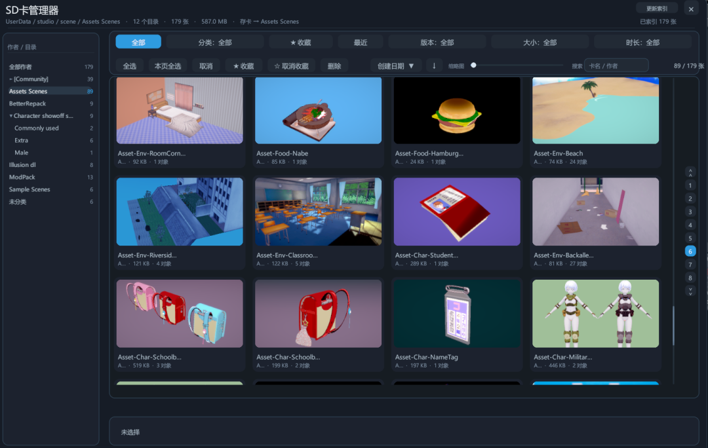
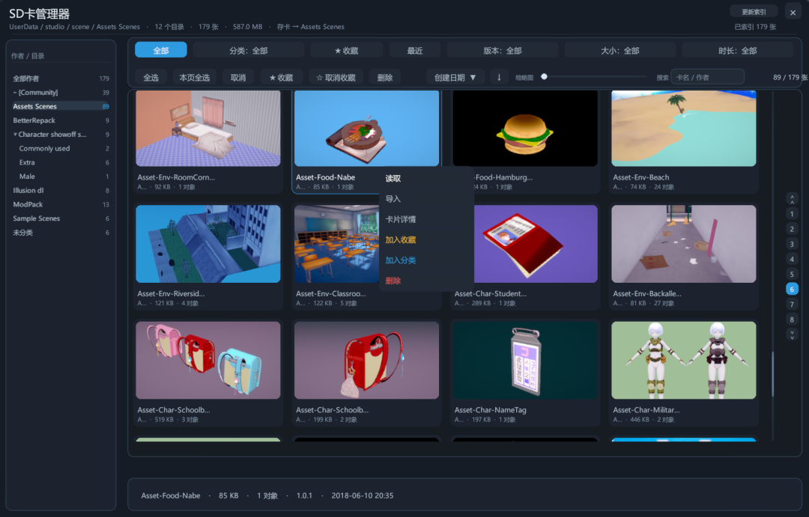

<h1 align="center">SD卡管理器</h1>

<p align="center">KK Scene Browser 1.0.0</p>

Koikatsu（CharaStudio）场景卡浏览器：用自绘的卡片网格替换「设置 → 读取数据 → 场景卡」原生面板，支持递归扫描、作者目录树、搜索、排序筛选、收藏与自定义分类。扁平深色圆角风格。

> **通用版本**：同一份 `KK_SceneBrowser.dll` 同时支持 Koikatsu 与 Koikatsu Sunshine（KKS），**不需要区分版本**。两者都是 `CharaStudio.exe`，PNG 解码与界面绘制均已做双引擎兼容（KK 走 `Texture2D.LoadImage`，KKS 自动切到 `ImageConversion.LoadImage`）。

## 界面

- 顶部：`SD卡管理器` 标题、当前路径、索引状态、关闭按钮
- 筛选条：排序键 + 升降序、缩略图列数滑杆、搜索框（框外左侧「搜索」文字，点击即聚焦）、卡片计数、筛选 chip（全部 / ★收藏 / 最近 / 版本 / 大小 / 时长 / 分类）
- 左侧：作者 / 目录树，逐级展开，行尾显示卡数，**双击目录行在资源管理器中打开该文件夹**
- 中间：卡片网格（缩略图 + 卡名 + 大小/对象/目录），卡片默认无描边，选中或批量勾选时才显示蓝色描边
- 中右：滚动条与页码（可点页码跳转、点当前页输入页码；顶部 `∧∧` 回首页、底部 `∨∨` 到末页）
- 右侧：详情卡（预览、8 项元数据、完整路径、同目录张数、读取/导入/收藏）
- 底栏：批量按钮（全选 / 本页全选 / 取消 / 收藏 / 取消收藏 / 删除）
- 弹层：排序下拉、卡片菜单、收藏夹面板、输入框、确认框

<p align="center">
  
</p>

<p align="center">
  
</p>

## 功能

**扫描与列表**
- 递归扫描 `UserData\studio\scene`，顶层目录名即作者名
- 网格 4~10 列滑杆调列数，滚轮 / 拖动滚动条连续滚动
- 重新打开面板时比对根目录修改时间与 PNG 数量，有变化才重扫
- 记住上次浏览的作者 / 子目录

**排序、筛选、搜索**
- 排序：修改时间 / 创建日期 / 名称 / 大小 / 版本 / 时长，方向可切换
- 筛选可叠加：版本、大小、时长；开关型：收藏、最近
- 自定义时长区间支持 `15-45`、`20-`、`-40`、`30`（全角符号、波浪号、「到」「秒」均可）
- 搜索匹配卡名 / 作者 / 目录

**卡片操作**
- 单击卡片弹出操作菜单：读取、导入、卡片详情、加入/取消收藏、分类操作、删除
  - 普通视图为 `加入分类`；在某个分类视图内为 `移动到其他分类`（加入目标并从原分类移除）
  - 在分类视图内额外显示 `移出「分类名」`
- 右键菜单：只看这个作者、打开所在文件夹、复制卡名、复制完整路径；批量模式下为整批操作
- 双击卡片直接读取；删除走回收站（`SHFileOperation` + `FOF_ALLOWUNDO`）

**收藏与分类**
- 收藏与分类按文件路径持久化，一张卡可属于多个分类，不改动磁盘文件
- 收藏夹面板：顶部 `加入`（移动模式显示 `移动`）/ `移除` / `新建分类` / `关闭`，下方为分类列表；分类行与按钮默认灰色，选中后变为强调蓝
- 批量模式：底栏进入，单击勾选、`Shift+点击` 连选、`Esc` 退出
- 最近加载：内存内最多 40 条

**其它**
- 工作室「保存数据」下增加「覆盖数据」，把当前场景写回刚读取的卡
- 保存场景卡时默认存进最后读取那张卡的作者目录（可关）
- 缩略图后台解码、每帧限额、LRU 260 张；索引缓存 `kk.scene.browser.index.txt` 只重新解析变化过的卡

## 安装

1. 把 `KK_SceneBrowser.dll` 放进 `<游戏根目录>\BepInEx\plugins\`
2. 启动 `CharaStudio.exe`，打开「设置 → 读取数据 → 场景卡」
3. 生效确认：`BepInEx\LogOutput.log` 中出现 `KK Scene Browser` 加载信息

只在 `CharaStudio.exe` 内加载，需要 BepInEx 5.4.x（x64）。KK 与 KKS 装同一份 DLL 即可，无需按版本分别编译或替换。

## 快捷键

| 按键 | 作用 |
|---|---|
| `↑` `↓` `←` `→` | 网格内移动选中 |
| `PageUp` / `PageDown` | 翻三行 |
| `Home` / `End` | 首张 / 末张 |
| `Enter` | 读取选中卡 |
| `Esc` | 依次关闭弹层 / 退出批量 / 清空搜索 / 关闭面板 |

## 数据与配置

`BepInEx\config\` 下纯文本，删除即重置：

| 文件 | 内容 |
|---|---|
| `kk.scene.browser.favs.txt` | 收藏 |
| `kk.scene.browser.collections.txt` | 分类库（`#分类名` + 逐行路径） |
| `kk.scene.browser.state.txt` | 上次浏览位置、时长档位、自定义区间 |
| `kk.scene.browser.index.txt` | 索引缓存（版本 / 对象数 / 时长） |

`kk.scene.browser.cfg`：

| 键 | 默认 | 说明 |
|---|---|---|
| `General / Enabled` | true | 总开关 |
| `General / Recursive scan` | true | 递归扫描 |
| `Performance / Thumbnail budget per frame (ms)` | 6 | 每帧解码缩略图的时间上限 |
| `UI / Grid columns` | 4 | 每行卡片数（4~10） |
| `UI / Hide BrowserFolders bottom menu` | true | 面板打开时隐藏 BrowserFolders 底部按钮条 |
| `UI / Hide native scene panel` | true | 面板打开时隐藏原生场景卡面板 |
| `Save / Save scene to current author folder` | true | 存卡到当前作者目录 |

## 从源码编译

仓库不含游戏程序集，脚本直接用内置 Roslyn（`_tools\roslyn`）对着游戏的 Managed / BepInEx 程序集编译，无需 .NET SDK：

```powershell
powershell -NoProfile -ExecutionPolicy Bypass -File tools\build.ps1 -Deploy
```

- 默认游戏目录 `E:\game\GDAkk\Koikatu`，用 `-GameRoot "<游戏根目录>"` 改
- 产物 `out\KK_SceneBrowser.dll`（含 `.pdb`）；`-Deploy` 会备份并复制到 `BepInEx\plugins\`

```
src\KK_SceneBrowser\      Koikatsu 版源码
  SceneBrowserPlugin.cs   主逻辑 + 全部界面构建
  UiTheme.cs              色板 + 运行时圆角九宫格贴图
  PngAssist.cs            PNG 尾部元数据读取
  CellClick.cs / ScrollCatcher.cs / ScrollTrackDrag.cs / SliderDrag.cs
tools\build.ps1           编译 + 可选部署
```

仓库只含源码与脚本：`_tools\roslyn\`（csc.exe）、`_decompiled\`（本地反编译参考）和 `out\` 构建产物不入库；从源码编译前请把 Roslyn 放到 `_tools\roslyn\`，或改用 .NET SDK 的 csc。

## 已知限制

- 只在 `CharaStudio.exe` 加载
- 版本 / 对象数 / 时长来自 PNG 尾部元数据，缺数据的卡不显示这几项，也不参与相应筛选
- KKS（1.1.x）卡可列出但本作无法读取，详情里会标注
- 「覆盖数据」需先读取过一张卡
- 收藏与分类按路径记录，卡移动/改名后条目失效
- 与 XUnity.AutoTranslator 共存时跳过本插件界面文本
